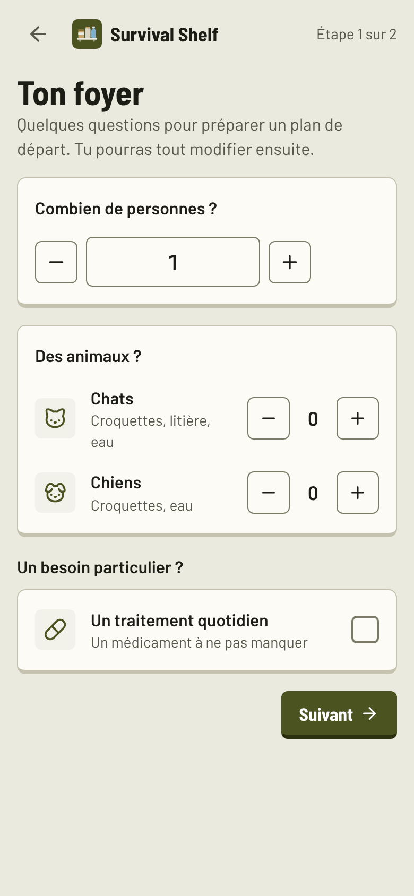
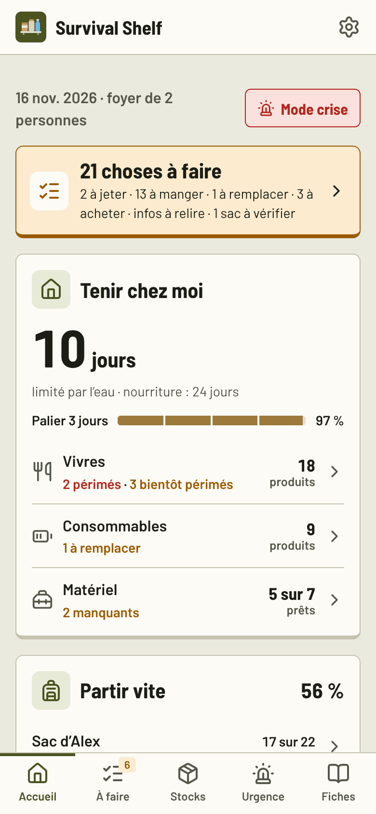
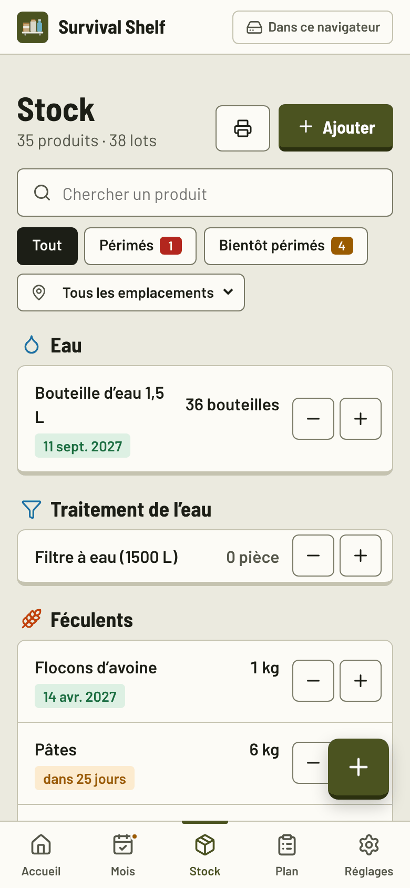
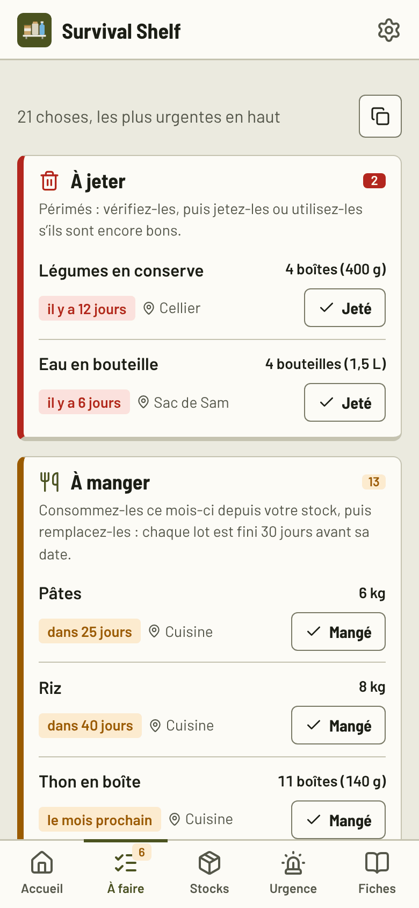
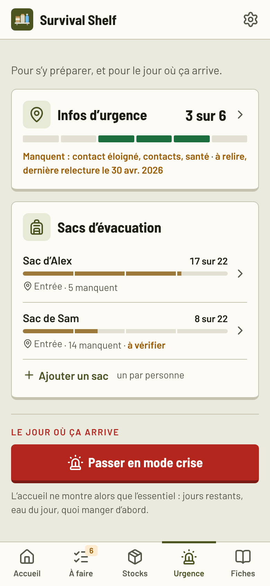
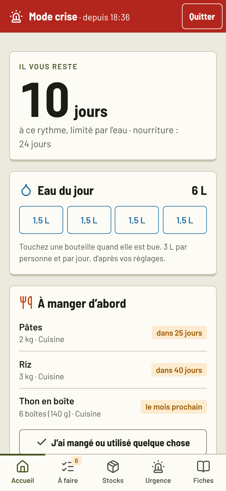
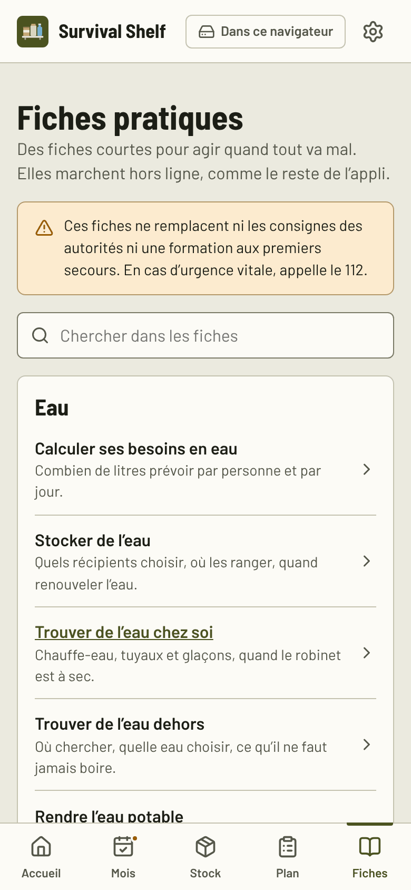

<p align="center">
  
</p>

<h1 align="center">Survival Shelf</h1>

<p align="center">
  <a href="README.md">English</a> · <b>Français</b>
</p>

<p align="center">
  <b>Construisez votre stock de survie pas à pas, et ne laissez plus rien périmer.</b><br>
  Gratuit · Tourne sur votre propre appareil · Fonctionne hors ligne · Sans compte · Un simple fichier texte lisible sans l’application
</p>

<p align="center">
  <a href="https://sylvaindeloux.github.io/survival-shelf/"><b>Essayer en ligne →</b></a><br>
  <sub>puis <a href="#pour-commencer">gardez votre propre copie</a> : l’application est faite pour tourner chez vous, hors ligne</sub>
</p>

<p align="center">
  
</p>

## Pourquoi

Une coupure de courant qui dure, une tempête, une inondation, l’eau du robinet qui n’est plus potable : en cas
de crise, les premiers jours sont les plus durs et les secours peuvent mettre du temps à arriver. C’est pour ça
que les pouvoirs publics, comme le
[gouvernement français](https://www.info.gouv.fr/risques/se-preparer-a-une-situation-durgence) et
l’[Union européenne](https://commission.europa.eu/topics/preparedness-union_en), demandent à chaque foyer de
pouvoir tenir seul au moins 72 heures.

« Avoir des réserves à la maison », c’est vite dit. En pratique :

- on ne sait pas combien acheter, ni par où commencer ;
- les aliments périment en silence au fond du placard ;
- au bout de quelques mois, on ne sait plus ce qu’on a, ni combien de temps cela tiendrait.

Survival Shelf s’occupe de tout cela. Indiquez-lui qui vit avec vous, il vous prépare une liste de courses.
Indiquez-lui ce que vous avez acheté, il suit les dates. Une fois par mois, il vous dit quoi manger, quoi jeter,
quoi remplacer et quoi acheter ensuite. Il vous prépare aussi pour le jour où ça arrive : les infos d’urgence
de votre foyer, un sac d’évacuation par personne et un mode crise.

## Comment ça marche

### 1. Quelques questions, et votre plan de départ est prêt

Combien de personnes, de chats et de chiens, et si quelqu’un a un traitement quotidien. L’application vous
propose une liste équilibrée : environ 2 200 kcal de nourriture par personne et par jour (riz, pâtes,
conserves, huile, sucre…), 3 L d’eau par personne et par jour, plus l’hygiène, les premiers secours,
l’éclairage, l’énergie et quelques outils. Décochez ce qui ne vous convient pas et ajustez les quantités.

<p align="center">
  
  
</p>

### 2. Construisez-le palier par palier

Personne n’achète un an de nourriture le premier jour. L’application découpe l’objectif en paliers : **3 jours,
1 semaine, 1 mois et 1 an** (modifiables). Pour chaque palier, elle vous montre où vous en êtes et ce qui manque
encore, produit par produit. Au-delà d’un mois, stocker toute votre eau n’est pas réaliste : un filtre à eau ou
des pastilles de purification prennent le relais.

<p align="center">
  
  
</p>

### 3. Notez ce que vous rangez

Quand vous faites vos courses, ajoutez chaque produit avec sa quantité, sa date de péremption et l’endroit où
vous le rangez (cellier, cuisine, sac d’évacuation…). Pas de date sur l’emballage ? L’application en estime une
à partir des [durées de conservation](docs/SHELF_LIFE.md) habituelles (page en anglais). Des pastilles de
couleur montrent ce qui périme bientôt, et l’application vous indique combien de jours votre foyer pourrait
tenir avec ce que vous avez, en nourriture et en eau.

Le stock est rangé en trois rayons, chacun suivi à sa façon : les **vivres**, mangés et remplacés au fur et à
mesure ; les **consommables** (piles, gaz, médicaments, hygiène…), remplacés avant leur date ; et le
**matériel** (outils, lampes, réchaud…), juste prêt ou manquant.

<p align="center">
  
</p>

### 4. Une fois par mois, un rendez-vous de 5 minutes

Une seule liste, en quatre parties :

- **À jeter** : ce qui est périmé.
- **À manger** : ce qu’il faut utiliser dans vos repas de tous les jours ce mois-ci, le plus ancien d’abord,
  avant qu’il ne périme. Ensuite, vous le rachetez. C’est la rotation du stock : vos réserves restent fraîches
  et rien n’est gaspillé.
- **À remplacer** : les piles, médicaments et autres consommables proches de leur date. Utilisez-les au
  quotidien, puis remettez-en des neufs sur l’étagère.
- **À acheter** : ce qui manque encore au palier que vous construisez, rangé par rayon.

Le moment venu, la liste vous rappelle aussi de relire les infos d’urgence avec votre foyer et de vérifier
chaque sac d’évacuation.

Cochez au fur et à mesure, partagez ou copiez la liste pour vos courses. L’application peut ajouter un rappel
récurrent à votre agenda (iPhone, Google, Outlook…) pour ne pas oublier. Le rendez-vous peut aussi revenir tous
les 3 ou 6 mois, au choix.

<p align="center">
  
</p>

Et pour le jour où il n’y a plus de courant : imprimez votre inventaire, avec de la place pour noter ce que
vous prenez.

### 5. Préparez-vous pour le jour où ça arrive

L’onglet **Urgence**, c’est là que vous vous préparez à l’avance, et ce que vous ouvrez le jour même.

- **Infos d’urgence** : le plan de votre foyer, au même endroit : numéros d’urgence, contact éloigné, lieux de
  rendez-vous, qui fait quoi, comment couper le gaz, l’eau et l’électricité, traitements et allergies de
  chacun. La fiche [Préparer un plan pour le foyer](guides/fr/les-bases/preparer-un-plan-pour-le-foyer.md)
  vous aide à le préparer avec votre foyer. Imprimez-le, et relisez-le tous les 6 mois.
- **Sacs d’évacuation** : un sac par personne, prêt à attraper s’il faut partir. La liste suit la fiche
  [Préparer un sac d’évacuation](guides/fr/les-bases/preparer-un-sac-d-evacuation.md). Ce que vous rangez dans
  un sac reste dans votre stock : l’application surveille donc aussi ses dates, et vous rappelle de vérifier
  chaque sac une fois par an.
- **Mode crise** : un bouton, et l’accueil ne montre plus que l’essentiel : combien de jours vous pouvez tenir,
  l’eau à boire aujourd’hui, bouteille par bouteille, et quoi manger d’abord. Des raccourcis mènent au numéro
  d’urgence, aux infos d’urgence, aux sacs et aux fiches.

<p align="center">
  
  
  
</p>

## Pour commencer

Survival Shelf est fait pour **tourner chez vous, sur vos propres appareils**, sans aucun service en ligne
derrière. Une fois que vous avez votre copie, il fonctionne **entièrement hors ligne**.

> [!CAUTION]
> **Ne dépendez pas de la version en ligne.** La page sylvaindeloux.github.io est hébergée par GitHub, une
> entreprise américaine : il faut internet, et rien ne garantit qu’elle restera accessible en cas de crise ou de
> conflit. Servez-vous-en pour essayer l’application et récupérer votre propre copie, puis gardez cette copie
> chez vous.

- **Garder votre propre copie** (recommandé). Téléchargez `survival-shelf.html`, depuis l’application
  (*Réglages → À propos → Télécharger la version fichier unique*) ou
  [directement](https://sylvaindeloux.github.io/survival-shelf/survival-shelf.html) (clic droit → *Enregistrer
  le lien sous…*). C’est un seul fichier qui s’ouvre dans n’importe quel navigateur sur un ordinateur, depuis
  le disque, une clé USB ou un dossier partagé : rien à installer, pas besoin de réseau. Gardez-en plusieurs
  copies, par exemple sur une clé USB à côté de votre fichier de données.
- **L’héberger chez vous.** Mettez ce même fichier sur votre propre serveur web (un NAS, un Raspberry Pi…) pour
  y accéder depuis tous les appareils de la maison par votre réseau local, ou construisez l’application complète
  depuis les sources (voir [CONTRIBUTING.md](.github/CONTRIBUTING.md), en anglais).
- **L’installer sur votre téléphone.** Ouvrez la page web, puis :
  - iPhone ou iPad (Safari) : bouton Partager → *Sur l’écran d’accueil* ;
  - Android (Chrome) : menu ⋮ → *Installer l’application* ou *Ajouter à l’écran d’accueil*.

  L’application est alors enregistrée sur votre téléphone et s’ouvre comme n’importe quelle application, avec
  ou sans réseau. Pratique, mais la réinstaller ou la mettre à jour dépend de GitHub : gardez aussi le fichier
  unique.

Ensuite, choisissez **Démarrer mon stock**, ou **Essayer avec un exemple** pour découvrir l’application d’abord.

## Vos données restent les vôtres, même sans l’application

Pas de compte, pas de serveur, pas de pistage : **rien ne quitte votre appareil**. Tout est rangé dans **un seul
fichier texte**, `survival-shelf.md`, écrit en français ou en anglais comme l’application. Vous pouvez l’ouvrir,
le lire, l’imprimer et même **le modifier avec n’importe quel éditeur de texte** (Bloc-notes, TextEdit…), sans
l’application. Si l’application ne fonctionnait plus demain, votre liste serait toujours là :

```markdown
| Produit          | Quantité | Péremption | Emplacement | Ajouté     |
|------------------|----------|------------|-------------|------------|
| Eau en bouteille | 24       | 2027-08-06 | Garage      | 2026-09-10 |
| Riz              | 5        | 2028-09-09 | Cellier     | 2026-09-10 |
```

Consultez un [exemple complet](docs/examples/survival-shelf.fr.md) et le
[format du fichier](docs/FILE_FORMAT.fr.md) pour le modifier à la main.

La façon dont le fichier est tenu à jour dépend de votre navigateur :

- **Ordinateur avec Chrome ou Edge** : reliez le fichier une fois, et chaque modification y est enregistrée
  automatiquement. Rangez-le dans un dossier synchronisé (iCloud Drive, Dropbox…) pour le retrouver partout.
- **Téléphone, Safari ou Firefox** : l’application garde ses données dans le navigateur. **Exportez** votre
  fichier régulièrement (l’application vous le rappelle) et gardez-en une copie en lieu sûr : cloud, e-mail,
  clé USB.

> [!WARNING]
> Un navigateur peut effacer les données d’un site que vous n’avez pas ouvert depuis un moment (Safari le fait
> au bout de 7 jours). Installez l’application sur votre écran d’accueil et gardez toujours une copie à jour de
> votre fichier.

## Fiches pratiques

Avoir des réserves, c’est bien. Savoir quoi en faire, c’est mieux. Survival Shelf propose des fiches
pratiques : des pages courtes qui répondent chacune à une seule question (combien d’eau prévoir, comment la
rendre potable, où en trouver quand le robinet est à sec…), commencent par l’essentiel et citent leurs sources
officielles.

**[Lire les fiches](guides/fr/README.md)**

<p align="center">
  
  
</p>

- **Dans l’application**, elles sont sur la page Fiches, avec une recherche, et elles fonctionnent hors ligne.
  Vous pouvez les lire avant même d’avoir un stock.
- **Sans l’application**, ce sont de simples fichiers texte rangés par langue et par thème dans le dossier
  [`guides`](guides/) : lisez-les ici sur GitHub, copiez-les sur un téléphone ou une clé USB, ou imprimez
  celles qui comptent pour vous.

Treize thèmes sont disponibles : les bases, l’eau, la nourriture, le froid et la chaleur, le feu et l’énergie, la
santé et les premiers secours, l’hygiène, la communication et l’orientation, les catastrophes, à la maison, en
voiture, en extérieur et les milieux hostiles. Les fiches ne remplacent ni les consignes des autorités ni une
formation aux premiers secours : lisez l’[avertissement](#avertissement).

## Questions

**C’est vraiment gratuit ?**
Oui. Gratuit et open source (licence MIT), sans pub et sans compte.

**Il faut une connexion internet ?**
Seulement pour récupérer votre copie la première fois. Ensuite, elle fonctionne hors ligne. Ne comptez pas sur
la page en ligne en cas de crise : gardez la version fichier unique, qui n’a besoin d’aucun réseau.

**Ma famille peut l’utiliser sur plusieurs téléphones ?**
Chaque appareil garde sa propre copie. Pour partager, rangez le fichier dans un dossier partagé et ouvrez-le
depuis là, ou exportez-le sur un appareil et importez-le sur l’autre.

**Les quantités sont-elles adaptées à mon foyer ?**
Ce sont des bases raisonnables (environ 2 200 kcal et 3 L d’eau par personne et par jour, durées de
conservation tirées des fabricants et des agences de sécurité alimentaire), pas un avis médical. Ajustez-les
à votre foyer : enfants, personnes âgées, besoins de santé.

**Je dois jeter tout ce qui a dépassé sa date ?**
Non. La plupart des aliments ont une *date de durabilité minimale* (« à consommer de préférence avant ») :
après, ils restent sans danger si l’emballage est intact. Les médicaments et les pastilles de purification,
c’est différent : ne comptez plus dessus après leur date. Détails dans les
[durées de conservation](docs/SHELF_LIFE.md) (en anglais).

**Je peux ajouter mes propres produits ?**
Oui, n’importe quel produit, avec ce que votre foyer en utilise par jour ou le minimum que vous voulez avoir.

## Avertissement

Survival Shelf est un projet personnel et bénévole. Ce n’est pas une source officielle, et il ne remplace ni
les consignes des autorités, ni l’avis d’un professionnel (médecin, pharmacien, pompier…), ni une formation
aux premiers secours.

- **L’application donne des estimations.** Les quantités, les jours d’autonomie et les durées de conservation
  sont des repères généraux : vérifiez-les avec votre foyer et les étiquettes de vos produits.
- **Les fiches donnent des informations générales.** Elles sont écrites avec soin à partir de sources
  officielles, mais elles peuvent contenir des erreurs, ne plus être à jour, ou ne pas convenir à votre
  situation ou à votre pays.

Vous utilisez l’application et les fiches sous votre seule responsabilité. Elles sont fournies « en l’état »,
sans aucune garantie, et leurs auteurs et contributeurs ne peuvent pas être tenus responsables des
conséquences de leur utilisation, comme le prévoit la [licence MIT](LICENSE). En cas d’urgence vitale, appelez
le 112.

Vous avez repéré une erreur ?
[Signalez-la dans les issues](https://github.com/sylvaindeloux/survival-shelf/issues) : la corriger peut aider
quelqu’un d’autre.

## Contribuer

Survival Shelf est un projet personnel ouvert à toutes les aides : signalez un bug ou proposez une idée dans
les [issues](https://github.com/sylvaindeloux/survival-shelf/issues),
[traduisez l’application](.github/TRANSLATING.md) dans votre langue (guide en anglais), ou améliorez le code.
Tout est expliqué dans [CONTRIBUTING.md](.github/CONTRIBUTING.md) (en anglais).

Vous pouvez aussi soutenir le projet via [GitHub Sponsors](https://github.com/sponsors/sylvaindeloux). Il reste
gratuit dans tous les cas.

## Licence

[MIT](LICENSE) © Sylvain Deloux

Polices intégrées : [Barlow et Barlow Semi Condensed](app/src/assets/fonts/README.md), licence SIL Open Font 1.1.
Icônes : [Lucide](https://lucide.dev), licence ISC.
