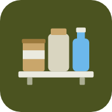
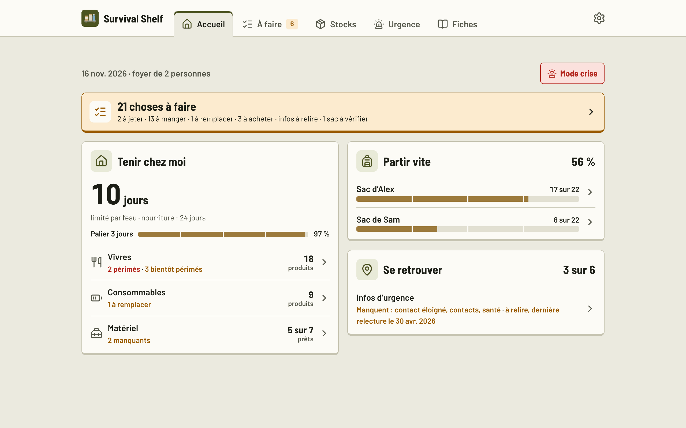
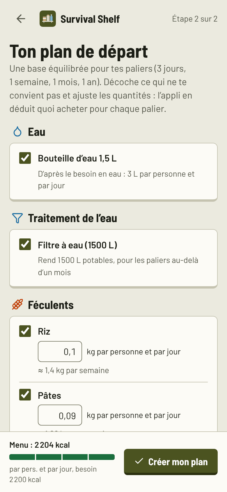
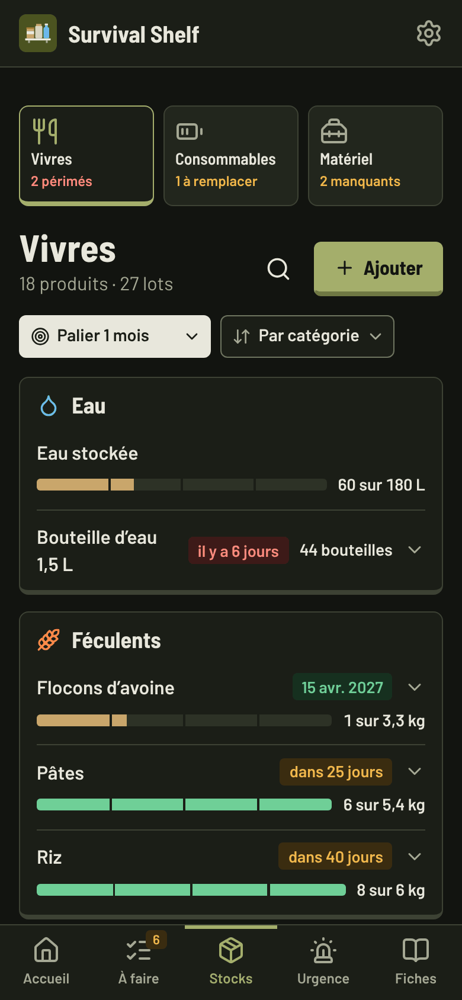
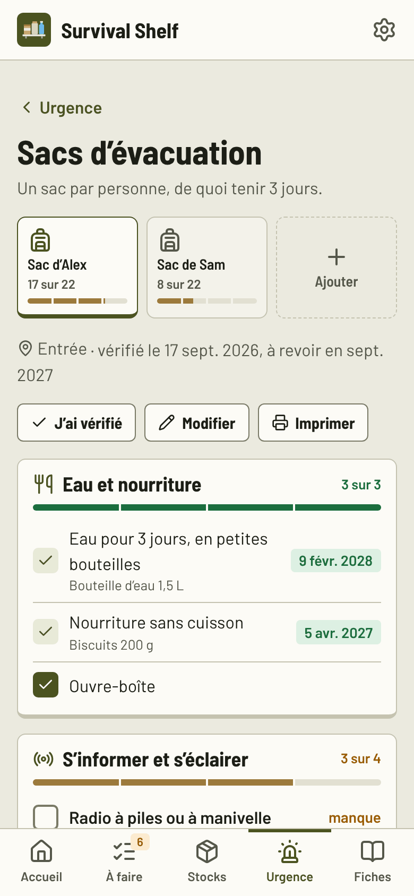
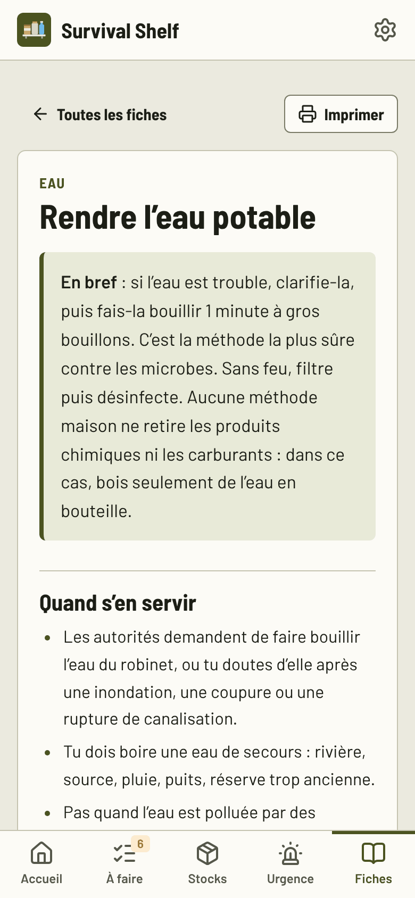

<p align="center">
  
</p>

<h1 align="center">Survival Shelf</h1>

<p align="center">
  <a href="README.md">English</a> · <b>Français</b>
</p>

<p align="center">
  <b>Construis ton stock de survie pas à pas, et ne laisse plus rien périmer.</b><br>
  Gratuit · Tourne sur ton propre appareil · Marche hors ligne · Sans compte · Un simple fichier texte lisible sans l’appli
</p>

<p align="center">
  <a href="https://sylvaindeloux.github.io/survival-shelf/"><b>Essayer en ligne →</b></a><br>
  <sub>puis <a href="#pour-commencer">garde ta propre copie</a> : l’appli est faite pour tourner chez toi, hors ligne</sub>
</p>

<p align="center">
  
</p>

## Pourquoi

Une coupure de courant qui dure, une tempête, une inondation, l’eau du robinet qui n’est plus potable : en cas
de crise, les premiers jours sont les plus durs et les secours peuvent mettre du temps à arriver. C’est pour ça
que les pouvoirs publics, comme le
[gouvernement français](https://www.info.gouv.fr/risques/se-preparer-a-une-situation-durgence) et
l’[Union européenne](https://commission.europa.eu/topics/preparedness-union_en), demandent à chaque foyer de
pouvoir tenir seul au moins 72 heures.

« Avoir des réserves à la maison », c’est vite dit. En pratique :

- tu ne sais pas combien acheter, ni par où commencer ;
- les aliments périment en silence au fond du placard ;
- au bout de quelques mois, tu ne sais plus ce que tu as, ni combien de temps ça tiendrait.

Survival Shelf s’occupe de tout ça. Dis-lui qui vit avec toi, il te fait une liste de courses. Dis-lui ce que
tu as acheté, il suit les dates. Une fois par mois, il te dit quoi manger, quoi jeter, quoi remplacer et
quoi acheter ensuite. Il te prépare aussi pour le jour où ça arrive : les infos d’urgence de ton foyer, un sac
d’évacuation par personne et un mode crise.

## Comment ça marche

### 1. Réponds à quelques questions, tu as ton plan de départ

Combien de personnes, de chats et de chiens, et si quelqu’un a un traitement quotidien. L’appli te propose une
liste équilibrée : environ 2 200 kcal de nourriture par personne et par jour (riz, pâtes, conserves, huile,
sucre…), 3 L d’eau par personne et par jour, plus l’hygiène, les premiers secours, l’éclairage, l’énergie et
quelques outils. Décoche ce qui ne te convient pas et ajuste les quantités.

<p align="center">
  
  
</p>

### 2. Construis-le palier par palier

Personne n’achète un an de nourriture le premier jour. L’appli découpe l’objectif en paliers : **3 jours,
1 semaine, 1 mois et 1 an** (tu peux les changer). Pour chaque palier, elle te montre où tu en es et ce qui
manque encore, produit par produit. Au-delà d’un mois, stocker toute ton eau n’est pas réaliste : un filtre à
eau ou des pastilles de purification prennent le relais.

<p align="center">
  
  
</p>

### 3. Note ce que tu ranges

Quand tu fais tes courses, ajoute chaque produit avec sa quantité, sa date de péremption et l’endroit où tu le
ranges (cellier, cuisine, sac d’évacuation…). Pas de date sur l’emballage ? L’appli en estime une à partir des
[durées de conservation](docs/SHELF_LIFE.md) habituelles (page en anglais). Des pastilles de couleur montrent
ce qui périme bientôt, et l’appli te dit combien de jours ton foyer pourrait tenir avec ce que tu as, en
nourriture et en eau.

Le stock est rangé en trois rayons, chacun suivi à sa façon : les **vivres**, mangés et remplacés au fur et à
mesure ; les **consommables** (piles, gaz, médicaments, hygiène…), remplacés avant leur date ; et le
**matériel** (outils, lampes, réchaud…), juste prêt ou manquant.

<p align="center">
  
</p>

### 4. Une fois par mois, un rendez-vous de 5 minutes

Une seule liste, en quatre parties :

- **À jeter** : ce qui est périmé.
- **À manger** : ce qu’il faut utiliser dans tes repas de tous les jours ce mois-ci, le plus ancien d’abord,
  avant que ça périme. Ensuite, tu le rachètes. C’est la rotation du stock : tes réserves restent fraîches et
  rien n’est gaspillé.
- **À remplacer** : les piles, médicaments et autres consommables proches de leur date. Utilise-les au
  quotidien, puis mets-en des neufs sur l’étagère.
- **À acheter** : ce qui manque encore au palier que tu construis, rangé par rayon.

Le moment venu, la liste te rappelle aussi de relire les infos d’urgence avec ton foyer et de vérifier chaque
sac d’évacuation.

Coche au fur et à mesure, partage ou copie la liste pour tes courses. L’appli peut mettre un rappel récurrent
dans ton agenda (iPhone, Google, Outlook…) pour ne pas oublier. Tu préfères tous les 3 ou 6 mois ? C’est toi
qui vois.

<p align="center">
  
</p>

Et pour le jour où il n’y a plus de courant : imprime ton inventaire, avec de la place pour noter ce que tu
prends.

### 5. Prépare-toi pour le jour où ça arrive

L’onglet **Urgence**, c’est là que tu te prépares à l’avance, et ce que tu ouvres le jour même.

- **Infos d’urgence** : le plan de ton foyer, au même endroit : numéros d’urgence, contact éloigné, lieux de
  rendez-vous, qui fait quoi, comment couper le gaz, l’eau et l’électricité, traitements et allergies de
  chacun. La fiche [Préparer un plan pour le foyer](guides/fr/les-bases/preparer-un-plan-pour-le-foyer.md)
  t’aide à le préparer avec ton foyer. Imprime-le, et relis-le tous les 6 mois.
- **Sacs d’évacuation** : un sac par personne, prêt à attraper s’il faut partir. La liste suit la fiche
  [Préparer un sac d’évacuation](guides/fr/les-bases/preparer-un-sac-d-evacuation.md). Ce que tu ranges dans un
  sac reste dans ton stock : l’appli surveille donc aussi ses dates, et te rappelle de vérifier chaque sac une
  fois par an.
- **Mode crise** : un bouton, et l’accueil ne montre plus que l’essentiel : combien de jours tu peux tenir,
  l’eau à boire aujourd’hui, bouteille par bouteille, et quoi manger d’abord. Des raccourcis mènent au numéro
  d’urgence, aux infos d’urgence, aux sacs et aux fiches.

<p align="center">
  
  
  
</p>

## Pour commencer

Survival Shelf est fait pour **tourner chez toi, sur tes propres appareils**, sans aucun service en ligne
derrière. Une fois que tu as ta copie, il marche **entièrement hors ligne**.

> [!CAUTION]
> **Ne dépends pas de la version en ligne.** La page sylvaindeloux.github.io est hébergée par GitHub, une
> entreprise américaine : il faut internet, et rien ne garantit qu’elle restera accessible en cas de crise ou de
> conflit. Sers-t’en pour essayer l’appli et récupérer ta propre copie, puis garde cette copie chez toi.

- **Garder ta propre copie** (recommandé). Télécharge `survival-shelf.html`, depuis l’appli (*Réglages →
  À propos → Télécharger la version fichier unique*) ou
  [directement](https://sylvaindeloux.github.io/survival-shelf/survival-shelf.html) (clic droit →
  *Enregistrer le lien sous…*). C’est un seul fichier qui s’ouvre dans n’importe quel navigateur sur un
  ordinateur, depuis le disque, une clé USB ou un dossier partagé : rien à installer, pas besoin de réseau.
  Garde-en plusieurs copies, par exemple sur une clé USB à côté de ton fichier de données.
- **L’héberger chez toi.** Mets ce même fichier sur un serveur web à toi (un NAS, un Raspberry Pi…) pour y
  accéder depuis tous les appareils de la maison par ton réseau local, ou construis l’appli complète depuis les
  sources (voir [CONTRIBUTING.md](.github/CONTRIBUTING.md), en anglais).
- **L’installer sur ton téléphone.** Ouvre la page web, puis :
  - iPhone ou iPad (Safari) : bouton Partager → *Sur l’écran d’accueil* ;
  - Android (Chrome) : menu ⋮ → *Installer l’application* ou *Ajouter à l’écran d’accueil*.

  L’appli est alors enregistrée sur ton téléphone et s’ouvre comme n’importe quelle appli, avec ou sans réseau.
  Pratique, mais la réinstaller ou la mettre à jour dépend de GitHub : garde aussi le fichier unique.

Ensuite, choisis **Démarrer mon stock**, ou **Essayer avec un exemple** pour faire un tour d’abord.

## Tes données restent à toi, même sans l’appli

Pas de compte, pas de serveur, pas de pistage : **rien ne quitte ton appareil**. Tout est rangé dans **un seul
fichier texte**, `survival-shelf.md`, écrit en français ou en anglais comme l’appli. Tu peux l’ouvrir, le lire,
l’imprimer et même **le modifier avec n’importe quel éditeur de texte** (Bloc-notes, TextEdit…), sans l’appli.
Si l’appli ne marchait plus demain, ta liste serait toujours là :

```markdown
| Produit               | Quantité | Péremption | Emplacement | Ajouté     |
|-----------------------|----------|------------|-------------|------------|
| Bouteille d’eau 1,5 L | 24       | 2027-08-06 | Garage      | 2026-09-10 |
| Riz                   | 5        | 2028-09-09 | Cellier     | 2026-09-10 |
```

Regarde un [exemple complet](docs/examples/survival-shelf.fr.md) et le [format du fichier](docs/FILE_FORMAT.fr.md)
si tu veux le modifier à la main.

La façon dont le fichier est tenu à jour dépend de ton navigateur :

- **Ordinateur avec Chrome ou Edge** : relie le fichier une fois, et chaque modification y est enregistrée
  automatiquement. Range-le dans un dossier synchronisé (iCloud Drive, Dropbox…) pour le retrouver partout.
- **Téléphone, Safari ou Firefox** : l’appli garde ses données dans le navigateur. **Exporte** ton fichier
  régulièrement (l’appli te le rappelle) et garde-en une copie en lieu sûr : cloud, e-mail, clé USB.

> [!WARNING]
> Un navigateur peut effacer les données d’un site que tu n’as pas ouvert depuis un moment (Safari le fait au
> bout de 7 jours). Installe l’appli sur ton écran d’accueil et garde toujours une copie à jour de ton fichier.

## Fiches pratiques

Avoir des réserves, c’est bien. Savoir quoi en faire, c’est mieux. Survival Shelf propose des fiches
pratiques : des pages courtes qui répondent chacune à une seule question (combien d’eau prévoir, comment la
rendre potable, où en trouver quand le robinet est à sec…), commencent par l’essentiel et citent leurs sources
officielles.

**[Lire les fiches](guides/fr/README.md)**

<p align="center">
  
  
</p>

- **Dans l’appli**, elles sont sur la page Fiches, avec une recherche, et elles marchent hors ligne. Tu peux
  les lire avant même d’avoir un stock.
- **Sans l’appli**, ce sont de simples fichiers texte rangés par langue et par thème dans le dossier
  [`guides`](guides/) : lis-les ici sur GitHub, copie-les sur un téléphone ou une clé USB, ou imprime celles
  qui comptent pour toi.

Treize thèmes sont disponibles : les bases, l’eau, la nourriture, le froid et la chaleur, le feu et l’énergie, la
santé et les premiers secours, l’hygiène, la communication et l’orientation, les catastrophes, à la maison, en
voiture, en extérieur et les milieux hostiles. Les fiches ne remplacent ni les consignes des autorités ni une
formation aux premiers secours : lis l’[avertissement](#avertissement).

## Questions

**C’est vraiment gratuit ?**
Oui. Gratuit et open source (licence MIT), sans pub et sans compte.

**Il faut une connexion internet ?**
Seulement pour récupérer ta copie la première fois. Ensuite, elle marche hors ligne. Ne compte pas sur la page
en ligne en cas de crise : garde la version fichier unique, qui n’a besoin d’aucun réseau.

**Ma famille peut l’utiliser sur plusieurs téléphones ?**
Chaque appareil garde sa propre copie. Pour partager, range le fichier dans un dossier partagé et ouvre-le
depuis là, ou exporte-le sur un appareil et importe-le sur l’autre.

**Les quantités sont-elles adaptées à mon foyer ?**
Ce sont des bases raisonnables (environ 2 200 kcal et 3 L d’eau par personne et par jour, durées de
conservation tirées des fabricants et des agences de sécurité alimentaire), pas un avis médical. Ajuste-les à
ton foyer : enfants, personnes âgées, besoins de santé.

**Je dois jeter tout ce qui a dépassé sa date ?**
Non. La plupart des aliments ont une *date de durabilité minimale* (« à consommer de préférence avant ») :
après, ils restent sans danger si l’emballage est intact. Les médicaments et les pastilles de purification,
c’est différent : ne compte plus dessus après leur date. Détails dans les
[durées de conservation](docs/SHELF_LIFE.md) (en anglais).

**Je peux ajouter mes propres produits ?**
Oui, n’importe quel produit, avec ce que ton foyer en utilise par jour ou le minimum que tu veux avoir.

## Avertissement

Survival Shelf est un projet personnel et bénévole. Ce n’est pas une source officielle, et il ne remplace ni
les consignes des autorités, ni l’avis d’un professionnel (médecin, pharmacien, pompier…), ni une formation
aux premiers secours.

- **L’appli donne des estimations.** Les quantités, les jours d’autonomie et les durées de conservation sont
  des repères généraux : vérifie-les avec ton foyer et les étiquettes de tes produits.
- **Les fiches donnent des informations générales.** Elles sont écrites avec soin à partir de sources
  officielles, mais elles peuvent contenir des erreurs, ne plus être à jour, ou ne pas convenir à ta situation
  ou à ton pays.

Tu utilises l’appli et les fiches sous ta seule responsabilité. Elles sont fournies « en l’état », sans aucune
garantie, et leurs auteurs et contributeurs ne peuvent pas être tenus responsables des conséquences de leur
utilisation, comme le prévoit la [licence MIT](LICENSE). En cas d’urgence vitale, appelle le 112.

Tu as repéré une erreur ? [Signale-la dans les issues](https://github.com/sylvaindeloux/survival-shelf/issues) :
la corriger peut aider quelqu’un d’autre.

## Contribuer

Survival Shelf est un projet perso ouvert à toutes les aides : signale un bug ou propose une idée dans les
[issues](https://github.com/sylvaindeloux/survival-shelf/issues), [traduis l’appli](.github/TRANSLATING.md)
dans ta langue (guide en anglais), ou améliore le code. Tout est expliqué dans
[CONTRIBUTING.md](.github/CONTRIBUTING.md) (en anglais).

Tu peux aussi soutenir le projet via [GitHub Sponsors](https://github.com/sponsors/sylvaindeloux). Il reste
gratuit dans tous les cas.

## Licence

[MIT](LICENSE) © Sylvain Deloux

Polices intégrées : [Barlow et Barlow Semi Condensed](app/src/assets/fonts/README.md), licence SIL Open Font 1.1.
Icônes : [Lucide](https://lucide.dev), licence ISC.
