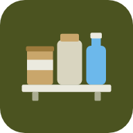
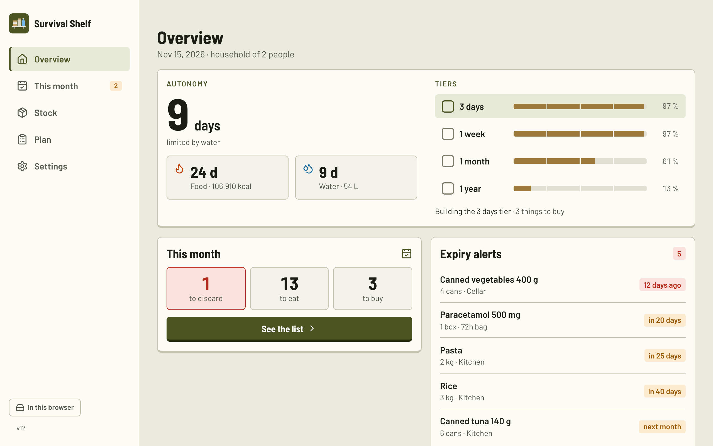
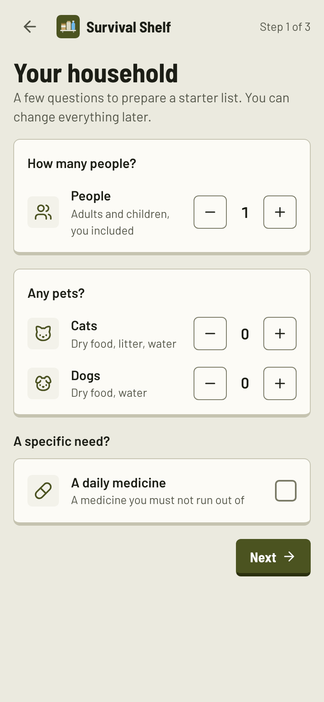
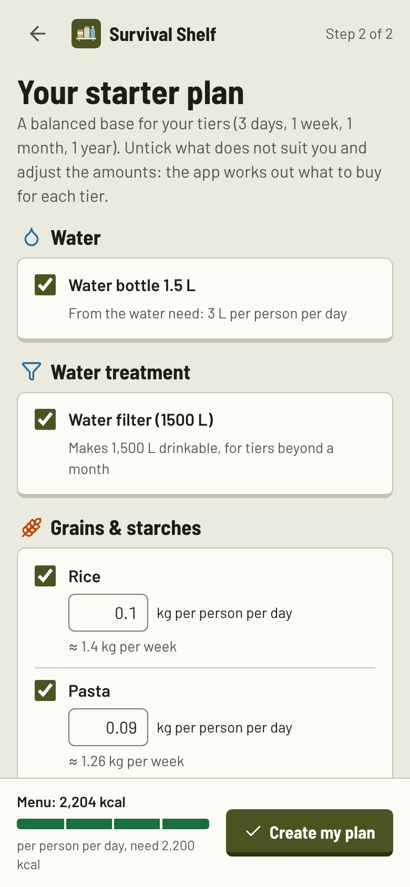
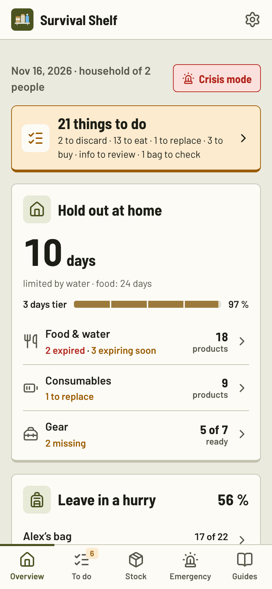
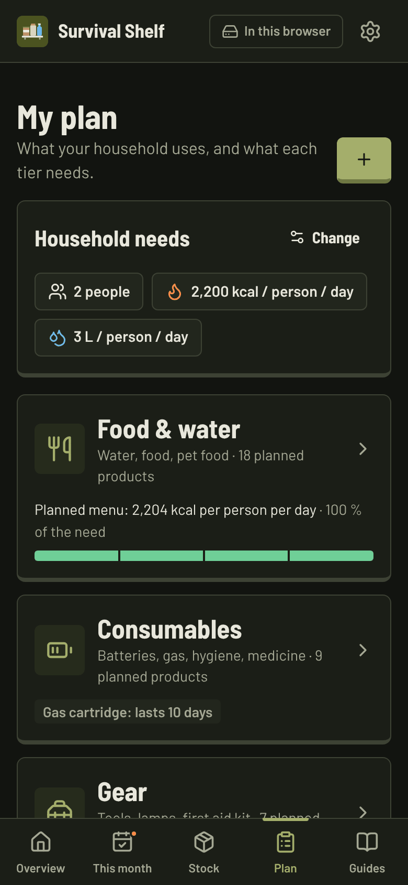
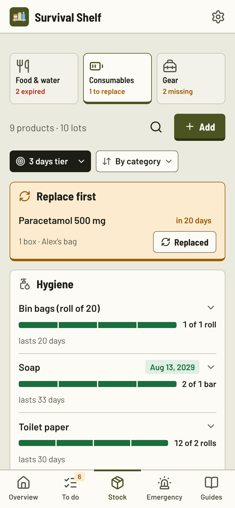
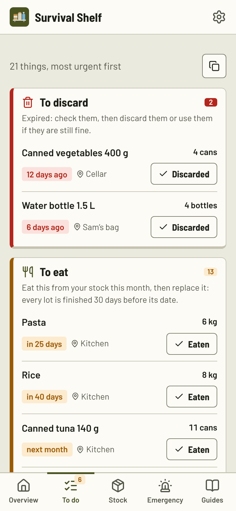
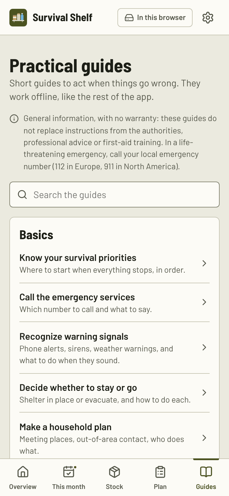
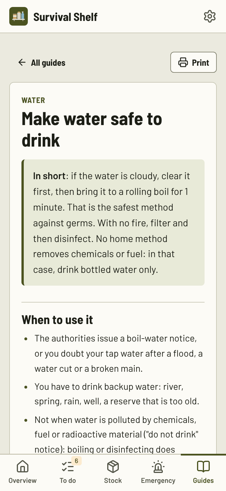

<p align="center">
  
</p>

<h1 align="center">Survival Shelf</h1>

<p align="center">
  <b>English</b> · <a href="README.fr.md">Français</a>
</p>

<p align="center">
  <b>Build your emergency supplies step by step, and never let them expire.</b><br>
  Free · Runs on your own device · Works offline · No account · A plain text file you can read without the app
</p>

<p align="center">
  <a href="https://sylvaindeloux.github.io/survival-shelf/"><b>Try it online →</b></a><br>
  <sub>then <a href="#get-started">keep your own copy</a>: the app is meant to run on your devices, offline</sub>
</p>

<p align="center">
  
</p>

## Why

A long power cut, a storm, a flood, tap water you can no longer drink: in a crisis, the first days are the
hardest and help can take a while to arrive. That is why public authorities, such as the
[European Union](https://commission.europa.eu/topics/preparedness-union_en) and the
[French government](https://www.info.gouv.fr/risques/se-preparer-a-une-situation-durgence), ask every household
to be able to manage on its own for at least 72 hours.

Saying "keep some supplies at home" is easy. Doing it is another story:

- you don't know how much to buy, nor where to start;
- food quietly expires at the back of the cupboard;
- after a few months, you no longer know what you have, nor how long it would last.

Survival Shelf takes care of all that. Tell it who lives with you, and it gives you a shopping plan. Tell it
what you bought, and it keeps track of the dates. Once a month, it tells you what to eat, what to throw away,
what to replace and what to buy next.

## How it works

### 1. Answer a few questions, get a starter plan

How many people, cats and dogs, and whether someone takes a daily medicine. The app suggests a balanced list:
about 2,200 kcal of food per person per day (rice, pasta, cans, oil, sugar…), 3 L of water per person per day,
plus hygiene, first aid, light, energy and a few tools. Untick what does not suit you and adjust the amounts.

<p align="center">
  
  
</p>

### 2. Build it tier by tier

Nobody buys a year of food on day one. The app splits the goal into tiers: **3 days, 1 week, 1 month and
1 year** (you can change them). For each tier it shows how far along you are and what is still missing.
Beyond a month, storing all your water is not realistic: a water filter or purification tablets take over.

<p align="center">
  
  
</p>

### 3. Note what goes on the shelf

When you shop, add each item with its quantity, its expiry date and where you keep it (cellar, kitchen,
72-hour bag…). No date on the packaging? The app estimates one from typical
[shelf lives](docs/SHELF_LIFE.md). Colored badges show what expires soon, and the app tells you how many days
your household could live on what you have, for food and for water.

The stock has three aisles, each looked after in its own way: **food & water**, eaten and replaced as you go;
**consumables** (batteries, gas, medicine, hygiene…), replaced before their date; and **gear** (tools, lamps,
stove…), simply ready or missing.

<p align="center">
  
</p>

### 4. Once a month, a 5-minute check-in

One list, four parts:

- **To discard**: what has expired.
- **To eat**: what to use in your everyday meals this month, oldest first, before it expires. Then replace it.
  This is stock rotation: your supplies stay fresh and nothing is wasted.
- **To replace**: batteries, medicine and other consumables close to their date. Use them up in daily life,
  then put new ones on the shelf.
- **To buy**: what the tier you are building is still missing, grouped by aisle.

Tick things off as you go, share or copy the list for your shopping. The app can put a recurring reminder in
your calendar (iPhone, Google, Outlook…) so you don't forget. Prefer every 3 or 6 months? Your call.

<p align="center">
  
</p>

And for the day the power is out: print your inventory, with room to note what you take.

## Get started

Survival Shelf is made to **run on your own devices**, with no online service behind it. Once you have your
copy, it works **fully offline**.

> [!CAUTION]
> **Don't depend on the online version.** The page at sylvaindeloux.github.io is hosted by GitHub, an American
> company: it needs internet, and nothing guarantees it will stay reachable during a crisis or a conflict. Use it
> to try the app and to get your own copy, then keep that copy at home.

- **Keep your own copy** (recommended). Download `survival-shelf.html`, from the app (*Settings → About →
  Download the single-file version*) or
  [directly](https://sylvaindeloux.github.io/survival-shelf/survival-shelf.html) (right-click → *Save link
  as…*). It is one file that opens in any browser on a computer, from the disk, a USB key or a shared folder:
  nothing to install, no network needed. Keep a few copies, for example on a USB key next to your data file.
- **Host it at home.** Put that same file on a web server you own (a NAS, a Raspberry Pi…) to reach it from
  every device of the house over your home network, or build the full app from the sources (see
  [CONTRIBUTING.md](.github/CONTRIBUTING.md)).
- **Install it on your phone.** Open the web page, then:
  - iPhone or iPad (Safari): Share button → *Add to Home Screen*;
  - Android (Chrome): menu ⋮ → *Install app* or *Add to Home screen*.

  The app is then stored on your phone and opens like any other app, with or without network. Handy, but
  reinstalling or updating it depends on GitHub: keep the single file too.

Then choose **Start my stock**, or **Try with sample data** to look around first.

## Your data stays yours, even without the app

No account, no server, no tracking: **nothing leaves your device**. Everything is kept in **one text file**,
`survival-shelf.md`, written in English or French like the app. You can open it, read it, print it and even
**edit it with any text editor** (Notepad, TextEdit…), without the app. If the app stopped working tomorrow,
your list would still be right there:

```markdown
| Product            | Qty | Expires    | Location | Added      |
|--------------------|-----|------------|----------|------------|
| Water bottle 1.5 L | 24  | 2027-08-06 | Garage   | 2026-09-10 |
| Rice               | 5   | 2028-09-09 | Cellar   | 2026-09-10 |
```

See a [complete example](docs/examples/survival-shelf.md) and the [file format](docs/FILE_FORMAT.md) if you want to
edit it by hand.

How the file is kept up to date depends on your browser:

- **Computer with Chrome or Edge**: link the file once and every change is saved into it automatically. Keep it
  in a synced folder (iCloud Drive, Dropbox…) to find it everywhere.
- **Phone, Safari or Firefox**: the app keeps its data inside the browser. **Export** your file regularly (the
  app reminds you) and keep a copy somewhere safe: cloud, email, USB key.

> [!WARNING]
> A browser can erase the data of a site you have not opened for a while (Safari does it after 7 days).
> Install the app on your home screen and always keep an up-to-date copy of your file.

## Practical guides

Having supplies is one thing, knowing what to do with them is another. Survival Shelf comes with practical
guides: short pages that each answer one question (how much water do I need, how do I make it safe to drink,
where do I find some when the tap runs dry…), start with the essentials and list their official sources.

**[Read the guides](guides/en/README.md)**

<p align="center">
  
  
</p>

- **In the app**, they are on the Guides page, with a search, and they work offline. You can read them before
  you have any stock.
- **Without the app**, they are plain text files in the [`guides`](guides/) folder, sorted by language and
  theme: read them here on GitHub, copy them to a phone or a USB stick, or print the ones that matter to you.

Thirteen themes are there: basics, water, food, cold and heat, fire and power, health and first aid, hygiene,
communication and navigation, disasters, at home, in the car, outdoors and hostile environments. The guides do
not replace instructions from the authorities or first-aid training: read the [disclaimer](#disclaimer).

## Questions

**Is it really free?**
Yes. Free and open source (MIT license), with no ads and no account.

**Do I need an internet connection?**
Only to get your copy the first time. After that, it works offline. Don't count on the online page in a
crisis: keep the single-file version, which needs no network at all.

**Can my family use it on several phones?**
Each device keeps its own copy. To share, keep the file in a shared folder and open it from there, or export it
on one device and import it on the other.

**Are the amounts right for me?**
They are reasonable starting points (about 2,200 kcal and 3 L of water per person per day, typical shelf lives
from manufacturers and food safety agencies), not medical advice. Adjust them to your household: children,
elderly people, health needs.

**Do I have to throw away everything past its date?**
No. Most foods carry a *best before* date: past it, they are still safe if the packaging is intact. Medicines
and water purification tablets are different: do not rely on them after their date. Details in
[shelf lives](docs/SHELF_LIFE.md).

**Can I add my own products?**
Yes, any product, with how much your household uses per day or the minimum you want to own.

## Disclaimer

Survival Shelf is a personal, volunteer project. It is not an official source, and it replaces neither
instructions from the authorities, nor the advice of a professional (doctor, pharmacist, firefighter…), nor
first-aid training.

- **The app gives estimates.** Quantities, days of autonomy and shelf lives are general starting points: check
  them against your household and the labels of your products.
- **The guides give general information.** They are written with care from official sources, but they may
  contain mistakes, be out of date, or not fit your situation or your country.

You use the app and the guides at your own risk. They are provided "as is", without warranty of any kind, and
their authors and contributors cannot be held liable for the consequences of their use, as the
[MIT license](LICENSE) states. In a life-threatening emergency, call your local emergency number (112 in
Europe, 911 in North America).

Found a mistake? [Open an issue](https://github.com/sylvaindeloux/survival-shelf/issues): fixing it may help
someone else.

## Contribute

Survival Shelf is a personal project that welcomes help: report a bug or suggest an idea in the
[issues](https://github.com/sylvaindeloux/survival-shelf/issues), [translate the app](.github/TRANSLATING.md)
into your language, or improve the code. Everything you need is in [CONTRIBUTING.md](.github/CONTRIBUTING.md).

You can also support the project through [GitHub Sponsors](https://github.com/sponsors/sylvaindeloux). It stays
free either way.

## License

[MIT](LICENSE) © Sylvain Deloux

Bundled fonts: [Barlow and Barlow Semi Condensed](app/src/assets/fonts/README.md), SIL Open Font License 1.1.
Icons: [Lucide](https://lucide.dev), ISC license.
