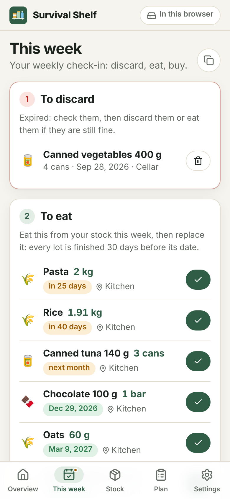
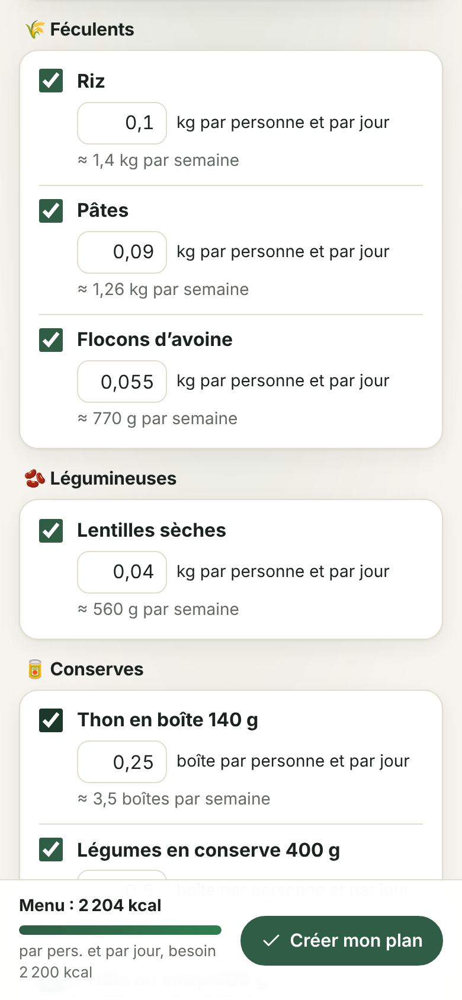
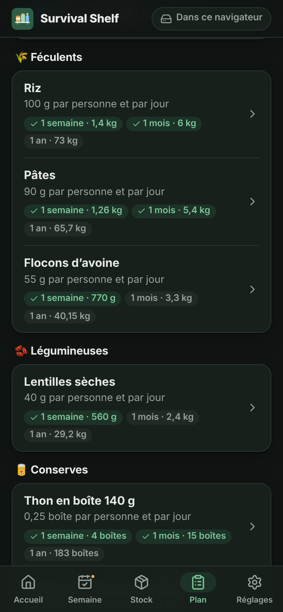
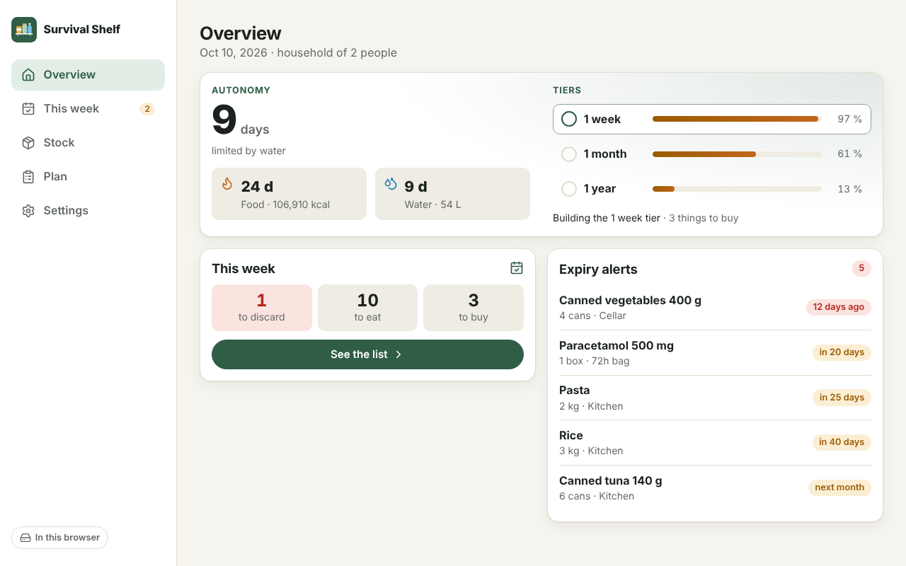

# Survival Shelf

**Build your survival stock step by step, and never let it expire.**

Survival Shelf is a free, open-source app to build and keep a survival stock (food, water, hygiene, first
aid, energy, gear…). It helps you start from nothing, tier by tier (1 week, then 1 month, then 1 year),
and once a week tells you what to discard, what to eat before it expires and what to buy next. It runs
**100% offline** in any modern browser, installs as an app (PWA), needs **no account and no server**, and
keeps your data in a **plain Markdown file** you can read and edit by hand.

<p align="center">
  
  
  
  
</p>

## Features

- **Starter plan**: answer two questions (how many people, any baby, pet or daily medicine) and get a
  balanced plan of about 2200 kcal per person per day, plus water, hygiene, first aid, energy and gear.
  Untick what does not suit you and adjust the amounts.
- **Autonomy tiers**: 1 week, 1 month and 1 year by default (editable). Each product has a use per day or a
  minimum to own, per person or for the household; the app works out what every tier needs and shows how far
  along you are. Beyond a month of stored water, filters and purification tablets take over.
- **Weekly or monthly check-in**: one list with the expired lots to discard, what to eat this week so nothing
  expires (progressive rotation, oldest first), and what to buy for the tier being built. Tick things off in
  one tap, share or copy the list.
- **Calendar reminder**: without a server the app cannot notify you, so it gives you a recurring `.ics` event
  for your calendar (iPhone, Google, Outlook…).
- **Stock by product and lot**: quantity, expiry date (day or month precision), location. Color-coded expiry
  badges, search, filters by status and location. Consume or discard oldest first (FEFO), with undo.
- **Autonomy**: how many days your household can live on the stock, for food (calories) and water. The
  estimate simulates eating oldest first and counts what would expire before its turn.
- **Built-in catalog** of about 60 common items with approximate calories and shelf life.
- **Printable inventory** with room to tally what you take, for when there is no power.
- English and French, light and dark themes, phone and desktop layouts.

<p align="center">
  
</p>

## Your data

Everything lives in one file, `survival-shelf.md`. See the [file format](docs/FILE_FORMAT.md) and a
[complete example](examples/survival-shelf.md).

| Browser                                              | How the file is kept up to date                                             |
|------------------------------------------------------|-----------------------------------------------------------------------------|
| Chrome, Edge, Brave, Opera on a computer             | The file is **linked**: every change is saved into it automatically, and edits made in a text editor are picked up when you come back to the app. |
| Firefox, Safari, iOS, most phones                    | The app keeps a working copy in the browser. **Import** and **export** (or share) the file, the app reminds you to back it up. |

Browsers can delete the data of websites you do not use for a while (Safari after 7 days). Install the app
(Add to Home Screen) and keep your file exported or linked.

## Getting started

- **Use it online**: open the app hosted on GitHub Pages, then install it from the browser menu. Once loaded,
  it works without any connection.
- **Single file**: download `survival-shelf.html` (link in Settings → About) and open it from a disk or a USB
  key, no installation needed.
- **Self-host**: `npm run build` produces static files in `dist/` that any web server can serve.

## Development

Requirements: Node.js 20.19+ (or 22.12+).

```sh
npm install
npm run dev          # development server
npm test             # unit tests (Vitest)
npm run check        # type checks (svelte-check + tsc)
npm run build        # PWA in dist/
npm run build:single # single self-contained HTML file in dist-single/
npm run build:all    # both, with the single file copied to dist/survival-shelf.html
```

Stack: [Svelte 5](https://svelte.dev) + TypeScript + [Vite](https://vite.dev), [vite-plugin-pwa](https://vite-pwa-org.netlify.app)
for the service worker, [Lucide](https://lucide.dev) icons. No CSS framework, no runtime dependency beyond Svelte.

```
src/
  lib/core/      Pure logic, no UI: Markdown parser/writer, stock operations, autonomy, rotation,
                 tiers (plan.ts), check-in, calendar reminder (ics.ts), catalog
  lib/storage/   IndexedDB working copy and file access (File System Access API, import/export)
  lib/i18n/      English (reference) and French messages
  lib/ui/        Shared components and dialogs
  lib/app.svelte.ts  App state: loading, saving, syncing with the linked file
  views/         Screens
docs/            File format and screenshots
examples/        Example data file
```

The business logic in `src/lib/core` is covered by unit tests; please add tests with your changes.

## Ideas for later

- Autonomy over time chart ("how long will I last in 6 months if I do nothing?").
- Several kits (cellar, car, 72-hour bag) with a go-bag checklist.
- Grace period for "best before" items, still edible after the date.
- Nutrition beyond calories (proteins…), and a finer balance between food groups.
- Barcode scanning without any online database.

## License

[MIT](LICENSE) © Sylvain Deloux
