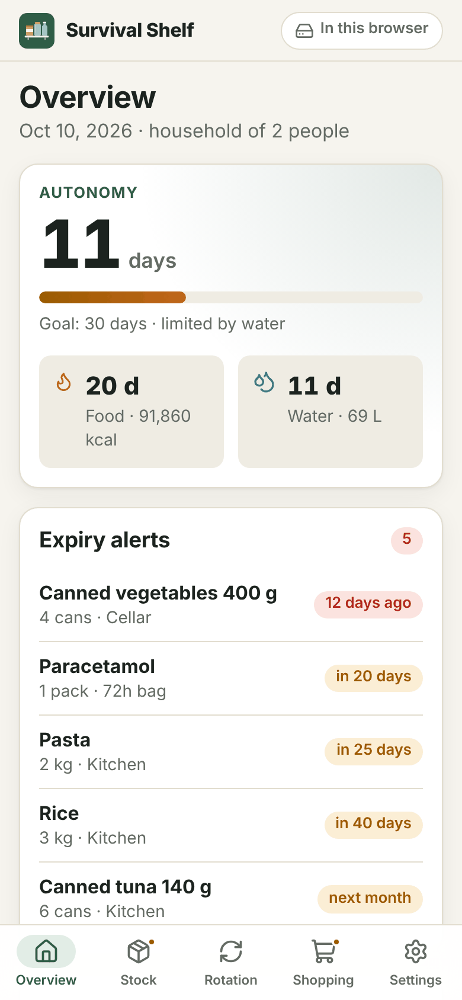
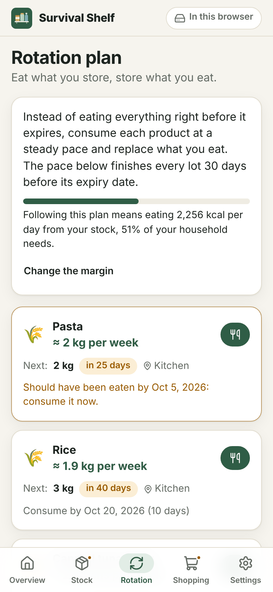
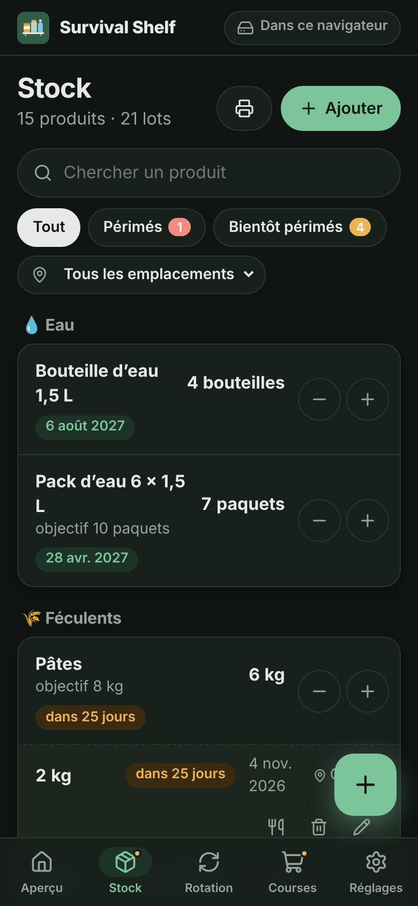

# Survival Shelf

**Know how long your supplies last, and never let them expire.**

Survival Shelf is a free, open-source app to manage a survival stock (food, water, first aid, batteries…):
expiry dates, household autonomy estimates and a progressive rotation plan. It runs **100% offline** in any
modern browser, installs as an app (PWA), needs **no account and no server**, and keeps your data in a
**plain Markdown file** you can read and edit by hand.

<p align="center">
  
  
  
</p>

## Features

- **Stock by product and lot**: quantity, expiry date (day or month precision), location. Color-coded expiry
  badges, search, filters by status and location.
- **Autonomy**: how many days your household can live on the stock, for food (calories) and water, limited by
  the weakest. The estimate simulates eating oldest first and counts what would expire before its turn.
- **Progressive rotation**: instead of eating everything right before it expires, the app gives a steady pace
  per product ("≈ 2.6 cans per week") that finishes every lot before its date, and tells you if that pace is
  more than your household can eat.
- **Consume or discard in one tap**, oldest expiry first (FEFO), with undo. Everything is logged.
- **Expiry alerts** for expired and soon-to-expire lots.
- **Shopping list**: products below their target, plus what is missing to reach your autonomy goal.
- **Printable inventory** with room to tally what you take, for when there is no power.
- **Presets** for common items (rice, pasta, canned food, water…) with approximate calories.
- English and French, light and dark themes, phone and desktop layouts.

## Your data

Everything lives in one file, `survival-shelf.md`. See the [file format](docs/FILE_FORMAT.md) and a
[complete example](examples/survival-shelf.md).

| Browser                                              | How the file is kept up to date                                             |
|------------------------------------------------------|-----------------------------------------------------------------------------|
| Chrome, Edge, Brave, Opera on a computer             | The file is **linked**: every change is saved into it automatically, and edits made in a text editor are picked up when you come back to the app. |
| Firefox, Safari, iOS, most phones                    | The app keeps a working copy in the browser. **Import** and **export** (or share) the file, the app reminds you to back it up. |

Browsers can delete the data of websites you do not use for a while (Safari after 7 days). Install the app
(Add to Home Screen) and keep your file exported or linked.

## Getting started

- **Use it online**: open the app hosted on GitHub Pages, then install it from the browser menu. Once loaded,
  it works without any connection.
- **Single file**: download `survival-shelf.html` (link in Settings → About) and open it from a disk or a USB
  key, no installation needed.
- **Self-host**: `npm run build` produces static files in `dist/` that any web server can serve.

## Development

Requirements: Node.js 20.19+ (or 22.12+).

```sh
npm install
npm run dev          # development server
npm test             # unit tests (Vitest)
npm run check        # type checks (svelte-check + tsc)
npm run build        # PWA in dist/
npm run build:single # single self-contained HTML file in dist-single/
npm run build:all    # both, with the single file copied to dist/survival-shelf.html
```

Stack: [Svelte 5](https://svelte.dev) + TypeScript + [Vite](https://vite.dev), [vite-plugin-pwa](https://vite-pwa-org.netlify.app)
for the service worker, [Lucide](https://lucide.dev) icons. No CSS framework, no runtime dependency beyond Svelte.

```
src/
  lib/core/      Pure logic, no UI: Markdown parser/writer, stock operations, autonomy, rotation, shopping
  lib/storage/   IndexedDB working copy and file access (File System Access API, import/export)
  lib/i18n/      English (reference) and French messages
  lib/ui/        Shared components and dialogs
  lib/app.svelte.ts  App state: loading, saving, syncing with the linked file
  views/         Screens
docs/            File format and screenshots
examples/        Example data file
```

The business logic in `src/lib/core` is covered by unit tests; please add tests with your changes.

## Ideas for later

- Autonomy over time chart ("how long will I last in 6 months if I do nothing?").
- Several kits (cellar, car, 72-hour bag) with a go-bag checklist.
- Calendar export (`.ics`) of expiry dates.
- Grace period for "best before" items, still edible after the date.
- Nutrition beyond calories (proteins…), specific needs (babies, pets, vital medicine).
- Barcode scanning without any online database.

## License

[MIT](LICENSE) © Sylvain Deloux
